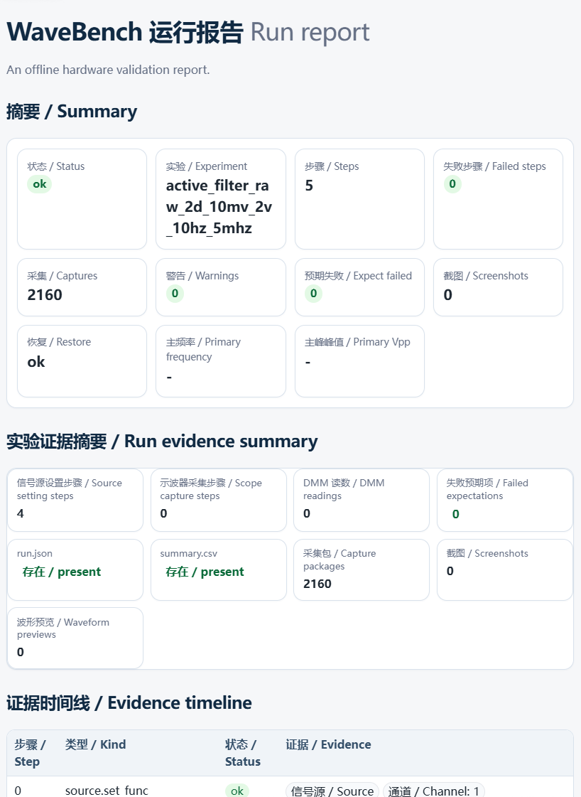

<p align="center">
  
</p>

<p align="center">
  <em>Automate the bench. Measure what matters.</em>
</p>

<p align="center">
  <a href="https://github.com/Scaxlibur/WaveBench/stargazers">
    
  </a>
  <a href="https://github.com/Scaxlibur/WaveBench/releases">
    
  </a>
  <a href="LICENSE">
    
  </a>
  
</p>

<p align="center">
  <strong>
    Instrument Control &middot;
    Automated Measurement &middot;
    Data Analysis &middot;
    Open Source
  </strong>
</p>

<p align="center">
  <sub>
    An open-source toolkit for automated laboratory measurement and instrument control.
  </sub>
</p>

---

<p align="center">
  <a href="docs/index.md">中文文档</a>
  &middot;
  <a href="docs/README_EN.md">English Overview</a>
  &middot;
  <a href="CHANGELOG.md">更新日志</a>
  &middot;
  <a href="https://github.com/Scaxlibur/wavebench-instrument-plugins">仪器插件仓库</a>
</p>

---

> [!WARNING]
> WaveBench 可以连接并控制真实实验设备。执行会改变仪器状态的命令前，应确认接线、输入阻抗、输出状态以及电压／电流限制。

WaveBench 是面向电子设计调试和日常实验的 Python 测量台。它将仪器操作、显式 run plan 和可复查的实验产物放在同一条工作流中：先离线检查，再连接实验台，最后执行受控实验。



## 适用范围

- 用信号源、示波器、电源和万用表组成可复现的实验流程。
- 用 `run check` 在不连接仪器的情况下检查 plan。
- 将采集包、运行记录和离线 HTML 报告保存在同一实验产物中。
- 用显式命令控制输出、采集和恢复，不在后台隐式执行 reset 或输出切换。
- 通过已安装的 instrument plugin 扩展具体仪器型号。

## 无硬件快速开始

正式发行包从 [GitHub Releases](https://github.com/Scaxlibur/WaveBench/releases) 获取，安装与开发线入口见[安装说明](docs/getting-started/installation.md)。在已安装 WaveBench 的环境中运行以下命令，可生成一个示例 plan，不会连接仪器或打开输出。

```bash
python -m wavebench --version
python -m wavebench run template --list
python -m wavebench run template source-scope-sine --output example.toml
```

按[无硬件快速开始](docs/getting-started/quickstart.md)准备演示配置并执行离线检查。以 `safety_limits=ok / 安全上限=通过` 结束时，表示示例 plan 已通过检查。

## 支持范围

| 类别 | Core 提供的通用能力 | 精确型号状态 |
| --- | --- | --- |
| 示波器 | 读取、采集、截图和受 capability 约束的控制 | 由内建或已安装插件 descriptor 声明 |
| 信号源／RF 信号源 | 显式配置、输出控制、run plan 和安全预检 | 由对应插件的 profile 与 evidence 声明 |
| 电源／万用表 | 状态、设定、读数与 run plan 集成 | 由对应插件 descriptor 声明 |
| 插件 | 发现、安装和公开插件 API | 具体型号、SCPI、quirk 和限制见[仪器插件仓库](https://github.com/Scaxlibur/wavebench-instrument-plugins) |

用[文档首页](docs/index.md)按任务进入正确页面；精确命令、字段和 capability 以程序输出、schema 与 descriptor 为准，而不是以本页摘要为准。

## 安全摘要

- `run schema`、`run template`、`run check` 和 `run report` 不连接仪器。
- `doctor` 与 `run verify` 会查询真实设备；先确认资源与接线。
- `run plan`、输出控制、采集和部分 TUI 操作可能改变仪器状态。
- WaveBench 不自动执行 `*RST`，也不会因设置电压、幅度或频率而自动开启输出。

开始真实实验前，请阅读[执行一次实验](docs/how-to/run-an-experiment.md)和[配置实验台](docs/getting-started/configure-bench.md)。

## 文档与贡献

Core 开发环境由 `uv.lock` 固定依赖版本：

```bash
uv sync --locked --extra dev --extra analysis --extra tui
uv run --no-sync pytest -q
uv run --no-sync ruff check .
```

`pdf`、`report3d` 和 `docs` 可按需用 `--extra` 加入。默认同步会移除未声明的包；
已安装仪器插件的运行环境应与开发环境分开，详见[管理仪器插件](docs/how-to/manage-plugins.md)。

- [文档首页](docs/index.md)
- [示例计划及硬件边界](plans/README.md)
- [管理仪器插件](docs/how-to/manage-plugins.md)
- [插件开发](docs/development/plugin-development.md)
- [更新日志](CHANGELOG.md)

WaveBench 使用 MIT 许可证。

## 特别感谢


感谢 [Linux DO 社区](https://linux.do/)提供交流和支持。


感谢 [Krill AI](https://www.krill-code.com/) 对本项目的赞助。
